# Rakuten France - Multimodal Product Classification

Classify French e-commerce product listings into **27 product-type codes** (`prdtypecode`)
from their **text** (title + description) and **product image**. DataScientest / Liora
bootcamp project, Rakuten challenge (`challengedata.ens.fr`).

---

## Workflow at a glance

*(horizontal — scroll right to follow the pipeline; full versions in [docs/workflow_v1.md](docs/workflow_v1.md) top-down and [docs/workflow_v2.md](docs/workflow_v2.md))*

```mermaid
flowchart LR
    classDef p0 fill:#cfe8ff,stroke:#1e6fd9,color:#0a2a4a,font-weight:bold;
    classDef eda fill:#d6f5d6,stroke:#2e9e2e,color:#0a3a0a;
    classDef prep fill:#ffe6cc,stroke:#e07b00,color:#5a2e00;
    classDef cpu fill:#d9f2f2,stroke:#1b8a8a,color:#053535;
    classDef gpu fill:#ece0ff,stroke:#7a3fd0,color:#2e0a5a;
    classDef valid fill:#ffd9e8,stroke:#d6336c,color:#5a0a2a;
    classDef rep fill:#fff3bf,stroke:#d9a200,color:#5a4500;
    classDef ckpt fill:#c3f0ca,stroke:#0f9d58,color:#063a1e,font-weight:bold;

    START([Goal: classify products into 27 categories from text + image]):::p0

    %% ===== DOWNLOAD =====
    subgraph DL["1 · Get the data"]
        direction TB
        d1["Download the title/description tables and the product images"]:::p0
    end
    START --> d1

    %% ===== EDA =====
    subgraph E["2 · Understand the data (EDA)"]
        direction TB
        e1["Inspect each file on its own before joining them"]:::eda
        e2["Join title + description; confirm rows line up"]:::eda
        e3["Profile structure, types and how many unique values"]:::eda
        e4["Describe how long the texts are (chars & words)"]:::eda
        e5["Measure missing values per field"]:::eda
        e6["Test whether the missingness is informative<br/>(missing-by-class, chi-square + Cramer's V)"]:::eda
        e7["Check for duplicate products"]:::eda
        e8["Map the class distribution and the 13.4:1 imbalance"]:::eda
        e9["Test the imbalance is real (chi-square goodness-of-fit)"]:::eda
        e10["Compare text length across classes (Kruskal-Wallis)"]:::eda
        e11["Detect languages with confidence intervals (Wilson)"]:::eda
        e12["Find the most frequent words / vocabulary size"]:::eda
        e13["Encode the 27 labels; record the modelling decisions"]:::eda
        e1-->e2-->e3-->e4-->e5-->e6-->e7-->e8-->e9-->e10-->e11-->e12-->e13
    end
    d1 --> e1

    %% ===== PREPROCESSING =====
    subgraph P["3 · Clean & prepare (keep ALL rows / languages)"]
        direction TB
        p1["Merge title + description into one text field"]:::prep
        p2["Lowercase the text"]:::prep
        p3["Remove URLs, emails, HTML tags & entities"]:::prep
        p4["Remove sizes (8 x 5) and bare numbers"]:::prep
        p5["Remove symbols but keep French accents"]:::prep
        p6["Tokenize the words"]:::prep
        p7["Remove French + English + German stopwords"]:::prep
        p8["Drop one-letter tokens; stem French words"]:::prep
        p9["Images: crop the white border, resize to 224, add flips"]:::prep
        p10["Sanity-check: no empty rows, all 84,916 kept"]:::prep
        p1-->p2-->p3-->p4-->p5-->p6-->p7-->p8
        p8-->p9-->p10
    end
    e13 --> p1
    CLEAN[("Clean dataset checkpoint<br/>84,916 products · text + image ready")]:::ckpt
    p10 --> CLEAN

    %% ===== FEATURES / SPLIT =====
    subgraph F["4 · Turn text into features & split safely"]
        direction TB
        f1["Split into train / test (80/20) (stratified, fixed seed,<br/>no leakage; checked with zero train/test ID overlap)"]:::cpu
        f2["Vectorize text with TF-IDF (1-2 grams, 20k features)"]:::cpu
        f3["Balance the minority classes with SMOTE"]:::cpu
        f4["Compare ways to compress features<br/>(full vs SVD vs chi-square vs mutual-info vs NMF)"]:::cpu
        f5["Visualize the classes in 2-D with t-SNE"]:::cpu
        f1-->f2-->f3-->f4-->f5
    end
    CLEAN --> f1

    %% ===== MODELS =====
    subgraph M["5 · Train & compare models"]
        direction TB
        subgraph MC["Classical text models (CPU)"]
            direction TB
            m1["Naive Bayes (baseline) → Logistic Regression → Linear SVM"]:::cpu
            m2["Decision Tree → Random Forest → XGBoost"]:::cpu
            m3["Tuned KNN & tuned XGBoost (Bayesian search)"]:::cpu
            m1-->m2-->m3
        end
        subgraph MT["Transformer text models (GPU)"]
            direction TB
            t1["French: CamemBERT, FlauBERT, DistilCamemBERT"]:::gpu
            t2["Multilingual: XLM-RoBERTa, mBERT"]:::gpu
            t1-->t2
        end
        subgraph MI["Image models (GPU)"]
            direction TB
            i1["EfficientNet-B0/B3, ResNet50, ConvNeXt-tiny, ViT-small"]:::gpu
        end
        fuse["Combine the best text + best image model<br/>(weighted late fusion, weight tuned on validation)"]:::gpu
        MC --> fuse
        MT --> fuse
        MI --> fuse
    end
    f5 --> MC
    f5 --> MT
    f5 --> MI
    RES[("Results checkpoint<br/>every model's macro-F1")]:::ckpt
    MC --> RES
    MT --> RES
    MI --> RES
    fuse --> RES

    %% ===== VALIDATION =====
    subgraph V["6 · Validate, interpret & stress-test"]
        direction TB
        v1["Rank all models by macro-F1"]:::valid
        v2["Cross-validate the leaders (stratified k-fold)"]:::valid
        v3["Per-class precision/recall/F1 + confusion matrix"]:::valid
        v4["Does class size predict accuracy? (Spearman)"]:::valid
        v5["Explain predictions: coefficients, SHAP, LIME"]:::valid
        v6["Check fairness across languages"]:::valid
        v7["Is the image gain significant? (McNemar test)"]:::valid
        v8["Ablation: remove each step, measure the impact"]:::valid
        v9["Imbalance experiments: SMOTE + per-class thresholds"]:::valid
        v10["Sanity checks: majority baseline, shuffled labels,<br/>memorize-tiny, inspect real predictions"]:::valid
        v11["Position against the state of the art"]:::valid
        v1-->v2-->v3-->v4-->v5-->v6-->v7-->v8-->v9-->v10-->v11
    end
    RES --> v1

    %% ===== REPORT =====
    subgraph R["7 · Report"]
        direction TB
        r1["Assemble every figure, table and result"]:::rep
    end
    v11 --> r1
    REPORT[("Shareable HTML report")]:::ckpt
    r1 --> REPORT
```



## 1. Goal

Given a product's `designation` (title), `description`, and `image`, predict its
`prdtypecode` (one of 27 commercial categories). This is a **multimodal, multi-class,
heavily imbalanced** text+image classification problem. Performance is judged on
**macro-F1** (every class weighted equally), not accuracy, because the classes are
very unevenly sized.

## 2. Research questions

Open questions the benchmark answers empirically - no answer is assumed in advance.

| # | Question | Answer (from results) |
|---|---|---|
| Q1 | Is **text or image** the stronger signal, and does **text+image fusion** beat the best single modality? |  |
| Q2 | Among **classical text models** (NB, LogReg, LinearSVC, trees, XGBoost, KNN), which fits sparse TF-IDF best? |  |
| Q3 | Among **transformers**, does a **French specialist (CamemBERT/FlauBERT)** beat a **multilingual model (XLM-RoBERTa/mBERT)** given the ~20% non-French tail? |  |
| Q4 | Among **image backbones** (EfficientNet-B0/B3, ResNet50, ConvNeXt, ViT), which inductive bias fits product photos best? |  |
| Q5 | Does **keeping all languages** beat dropping non-FR/EN rows, and does **SMOTE** beat class-weighting for the 13.4:1 imbalance (ranked by **macro-F1**)? |  |

## 3. Dataset

| Property | Value |
|---|---|
| Training products | **84,916** |
| Test products (challenge) | **13,812** |
| Target classes (`prdtypecode`) | **27** |
| Class imbalance | **13.4 : 1** (largest `2583 Pool accessories` n=10,209 / smallest `1180 Trading figures` n=764) |
| `description` missing | **35.1%** (`designation` never missing) |
| Median combined text length | **314 characters** |
| Dominant language | French (~80%), tail: EN, DE, ES, NL, IT |
| Files | `X_train_update.csv`, `Y_train_CVw08PX.csv`, `X_test_update.csv`, `images.zip` (~2.5 GB) |
| Image naming | `image_{imageid}_product_{productid}.jpg` |

The only usable numeric fields are IDs - **all the predictive signal is in the text and
the image**.

## 4. Pipeline steps

Four phases, each mapped to one script:

| Phase | What it does | Script |
|---|---|---|
| **Phase 0** | Download data (CSVs + image archive) into `data/` | `src/data/make_dataset.py` |
| **Phase A** | Descriptive analysis / EDA (18 steps) + data checks + statistical tests | `src/features/build_features.py` |
| **Phase B** | Preprocessing - text + image (22 steps) + step-demo + sanity asserts | `src/features/build_features.py` |
| **Phase C** | Modeling - build/train all candidate models (26 steps) | `src/models/benchmark_all_models.py` |
| **Phase D** | Model validation - CV, metrics, interpretability, significance, ablation (16 steps) | `src/models/validate_model.py` |

### Phase 0 - Download
1. Download `X_train_update.csv`, `Y_train_CVw08PX.csv`, `images.zip` (~2.5 GB) into `data/`; unzip images.

### Phase A - Descriptive analysis / EDA (18 steps)
1. Inspect X and Y SEPARATELY before merge (shape/head/dtypes; `len(X)==len(Y)`; row-key identity assert)
2. Merge X+Y, fillna, build combined text
3. View the data (first records)
4. Structure - `info()`, dtypes, cardinality (`nunique`)
5. Descriptive stats - char-length, word counts (`describe`, quartiles)
6. Missing values per column
7. Missing-description rate by category - MNAR (chi-square contingency + Cramer's V)
8. Duplicate analysis (exact + text-subset)
9. Class distribution + imbalance 13.4:1 [figure]
10. Chi-square goodness-of-fit on class balance
11. Cumulative imbalance curve [figure]
12. Text-length distribution [figure]
13. Kruskal-Wallis - text length across classes
14. Language detection + distribution + Wilson CIs [figure]
15. Top tokens / vocabulary size [figure]
16. Bivariate - median word count per class [figure]
17. Target encoding (27 codes -> 0..26)
18. Decisions taken from the EDA

### Phase B - Preprocessing (22 steps; KEEPS ALL ROWS / LANGUAGES)
Text:
1. Merge `designation` + `description` (fillna `''`)
2. Lowercase
3. Strip URLs
4. Strip emails
5. Strip HTML tags (BeautifulSoup)
6. Strip HTML entities (`&eacute;`)
7. Strip dimensions ("8 x 5")
8. Strip bare numbers
9. Strip special chars (keep French accents)
10. Collapse whitespace
11. Tokenize (TweetTokenizer)
12. Keep all languages (no row dropping)
13. Remove stopwords (FR + EN + DE)
14. Min word length > 1
15. Snowball French stemming (classical branch; off for transformers)
16. Step-by-step demo on one real product (raw -> final)
17. Vocabulary effect (avg tokens before/after cleaning)
Image:
18. Load image by `image_{imageid}_product_{productid}.jpg`
19. Corner-threshold crop of the white border
20. Resize 224x224
21. Data augmentation - flips (train only)
Sanity:
22. Preprocessing sanity asserts (no-NaN text, all rows kept, TF-IDF width, train/test ID-overlap, zero train/test ID overlap, LabelEncoder round-trip)

### Phase C - Modeling: build / train (26 steps)
1. Feature engineering - TF-IDF (1,2)-grams, 20k, min_df=3 (fit on train only)
2. Stratified train/test split (80/20), seed 42 - no leakage (+ shape/width checks)
3. Imbalance handling - class-weight or SMOTE; rank by macro-F1
4. Dimension-reduction comparison - full TF-IDF vs TruncatedSVD-300/1000 vs chi2 SelectKBest-2000/5000 vs mutual-info-2000 vs PCA vs NMF
5. t-SNE 2-D visualization
6. Naive Bayes
7. Logistic Regression
8. LinearSVC
9. Decision Tree
10. Random Forest
11. XGBoost
12. KNN - BayesSearchCV + SMOTE (MCC)
13. XGBoost - BayesSearchCV + SMOTE (MCC)
14. CamemBERT
15. FlauBERT
16. XLM-RoBERTa
17. mBERT
18. DistilCamemBERT
19. EfficientNet-B0
20. ResNet50
21. EfficientNet-B3
22. ConvNeXt-tiny
23. ViT-small
24. Image feature extraction (frozen ResNet18, 512-d, L2-normalized)
25. Multimodal fusion - concat text + image (resize vs autocrop)
26. Weighted late fusion (weight tuned on validation)

### Phase D - Model validation (16 steps)
1. Model-comparison ranking [figure]
2. K-fold cross-validation (StratifiedKFold 3) - mean +/- std
3. Per-class metrics (classification_report)
4. Confusion matrix [figure] + top confusions
5. Spearman - class support vs F1
6. Coefficients per class (inherent interpretability)
7. SHAP global importance [figure]
8. SHAP local waterfalls - 3 correct + 1 wrong [figures]
9. SHAP beeswarm
10. LIME local check (independent)
11. Fairness - accuracy per detected language
12. McNemar significance test (multimodal gain)
13. Ablation study - remove each step, measure delta macro-F1 [figure]
14. Imbalance experiments - SMOTE, SMOTE-Tomek, per-class threshold tuning
15. Debugging sanity checks - majority baseline, shuffle-labels, memorize-tiny, inspect predictions
16. Literature / SOTA + recommended methods (implemented)

**Phases at a glance:** 0 = download - A = describe (18) - B = clean (22) - C = build models (26) - D = validate models (16).

## 5. Repository structure

```
notebooks/   exploration + per-member notebooks
src/
  data/         make_dataset.py        (Phase 0 - download)
  features/     build_features.py      (Phase A EDA + Phase B preprocessing)
  models/       benchmark_all_models.py (Phase C - build/train)
                validate_model.py       (Phase D - validation/interpretability)
  streamlit/    app.py                  (defense demo)
reports/        figures/ + result JSONs + Data-Audit table
models/         trained model artifacts
references/     bibliography
```


## 7. How to run (reproducible from scratch)

```bash
pip install -r requirements.txt          # core: Phases 0/A/B, classical C1-C13, Phase D (CPU is fine)
pip install -r requirements-gpu.txt      # OPTIONAL: GPU phases - transformers C14-C18, image C19-C24 (needs CUDA)
python src/data/make_dataset.py        # Phase 0: downloads CSVs (+images.zip if RAKUTEN_IMAGES_ZIP_ID set) into data/
python src/features/build_features.py  # Phase A+B: EDA figures + data/df_clean.csv
python src/models/benchmark_all_models.py  # Phase C: model zoo + dim-reduction/t-SNE figures + reports/benchmark_results.json
python src/models/validate_model.py    # Phase D: CV/SHAP/LIME/confusion/ablation figures + reports/validation_results.json
python src/make_report.py              # Phase E: one self-contained reports/rakuten_report.html (all figures + results)
```

All scripts **auto-create** their folders (`data/`, `reports/`, `reports/figures/`, `reports/logs/`, `.tmp/rakuten_cache/`). Run from the repo root. Every script is also a Jupyter file - the `#%%` markers let you open it and run **step by step**, seeing each step's text output + figure inline.

### Outputs by stage (where files land)
- **Phase 0** -> `data/X_train_update.csv`, `data/Y_train_CVw08PX.csv` (+ `data/images/` if downloaded)
- **Phase A/B** -> `reports/figures/A*.png`, `data/df_clean.csv` (the cleaned checkpoint)
- **Phase C** -> `reports/figures/C4_*.png`, `C5_*.png`, `reports/benchmark_results.json`, image caches in `.tmp/rakuten_cache/*.npy`
- **Phase D** -> `reports/figures/D*.png`, `reports/validation_results.json`
- **Phase E** -> `reports/rakuten_report.html` (figures embedded, shareable)

### Start from the uploaded checkpoint (skip Phase 0 + A + B)
This repo ships **`data/df_clean.csv.gz`** - the Phase A+B output (full 84,916 rows, already cleaned/merged/stemmed, with `text`, `text_nostem`, `y`, `prdtypecode`, `designation`, ids). A teammate can continue straight from Phase C without downloading raw data or re-running EDA/preprocessing:

```python
import pandas as pd
df = pd.read_csv('data/df_clean.csv.gz')   # pandas reads gzip directly - no manual unzip
```

Or just run the later scripts (they already load this file):
```bash
python src/models/benchmark_all_models.py   # Phase C - reads data/df_clean.csv(.gz)
python src/models/validate_model.py          # Phase D
python src/make_report.py                    # Phase E - HTML report
```
To rebuild the checkpoint from scratch instead, delete it and run Phase 0 + A + B.

### Resume from checkpoints (skip expensive stages)
The pipeline is checkpointed so you can start mid-way without redoing finished work:
- If `data/df_clean.csv` exists, skip Phase 0+A+B and start at Phase C.
- `benchmark_all_models.py` **resumes**: it loads `reports/benchmark_results.json` and skips any model already computed (re-running continues the slow BayesSearch / image / transformer models where it left off). Delete the JSON to force a full rebuild.
- Image features cache to `.tmp/rakuten_cache/*.npy` and are reused if present.
- GPU phases (transformers C14-C18, image models C19-C23, image extraction C24) **skip gracefully** if `torch`/GPU is absent, so the text pipeline runs on CPU alone.


## 6. Models benchmarked (full 84,916-corpus, common RS=42 split, macro-F1)

Every model is justified in `MODEL_SELECTION_JUSTIFICATION.md` (each tests a specific hypothesis
about the data). All trained from scratch, no cache. Results filled in after the benchmark run.

**Text - classical (TF-IDF):** Naive Bayes · Logistic Regression · LinearSVC · Decision Tree ·
Random Forest · XGBoost · KNN (BayesSearchCV + SMOTE) · XGBoost (BayesSearchCV + SMOTE)

**Text - transformers:** CamemBERT · FlauBERT · XLM-RoBERTa · mBERT · DistilCamemBERT

**Image:** EfficientNet-B0 · ResNet50 · EfficientNet-B3 · ConvNeXt-tiny · ViT-small

**Fusion:** best text + best image, late fusion, weight tuned on validation.

| Family | Best model | macro-F1 | Accuracy |
|---|---|---|---|
| Classical text |  |  |  |
| Transformer text |  |  |  |
| Image |  |  |  |
| **Multimodal fusion (best-of-all)** |  |  |  |
