# Rakuten 27-class Product Classification — Methodology Workflow

```mermaid
flowchart LR
    classDef p0 fill:#cfe8ff,stroke:#1e6fd9,color:#0a2a4a,font-weight:bold;
    classDef eda fill:#d6f5d6,stroke:#2e9e2e,color:#0a3a0a;
    classDef prep fill:#ffe6cc,stroke:#e07b00,color:#5a2e00;
    classDef cpu fill:#d9f2f2,stroke:#1b8a8a,color:#053535;
    classDef gpu fill:#ece0ff,stroke:#7a3fd0,color:#2e0a5a;
    classDef valid fill:#ffd9e8,stroke:#d6336c,color:#5a0a2a;
    classDef rep fill:#fff3bf,stroke:#d9a200,color:#5a4500;
    classDef ckpt fill:#c3f0ca,stroke:#0f9d58,color:#063a1e,font-weight:bold;

    START([Goal: classify products into 27 categories from text + image]):::p0

    %% ===== DOWNLOAD =====
    subgraph DL["1 · Get the data"]
        direction TB
        d1["Download the title/description tables and the product images"]:::p0
    end
    START --> d1

    %% ===== EDA =====
    subgraph E["2 · Understand the data (EDA)"]
        direction TB
        e1["Inspect each file on its own before joining them"]:::eda
        e2["Join title + description; confirm rows line up"]:::eda
        e3["Profile structure, types and how many unique values"]:::eda
        e4["Describe how long the texts are (chars & words)"]:::eda
        e5["Measure missing values per field"]:::eda
        e6["Test whether the missingness is informative<br/>(missing-by-class, chi-square + Cramer's V)"]:::eda
        e7["Check for duplicate products"]:::eda
        e8["Map the class distribution and the 13.4:1 imbalance"]:::eda
        e9["Test the imbalance is real (chi-square goodness-of-fit)"]:::eda
        e10["Compare text length across classes (Kruskal-Wallis)"]:::eda
        e11["Detect languages with confidence intervals (Wilson)"]:::eda
        e12["Find the most frequent words / vocabulary size"]:::eda
        e13["Encode the 27 labels; record the modelling decisions"]:::eda
        e1-->e2-->e3-->e4-->e5-->e6-->e7-->e8-->e9-->e10-->e11-->e12-->e13
    end
    d1 --> e1

    %% ===== PREPROCESSING =====
    subgraph P["3 · Clean & prepare (keep ALL rows / languages)"]
        direction TB
        p1["Merge title + description into one text field"]:::prep
        p2["Lowercase the text"]:::prep
        p3["Remove URLs, emails, HTML tags & entities"]:::prep
        p4["Remove sizes (8 x 5) and bare numbers"]:::prep
        p5["Remove symbols but keep French accents"]:::prep
        p6["Tokenize the words"]:::prep
        p7["Remove French + English + German stopwords"]:::prep
        p8["Drop one-letter tokens; stem French words"]:::prep
        p9["Images: crop the white border, resize to 224, add flips"]:::prep
        p10["Sanity-check: no empty rows, all 84,916 kept"]:::prep
        p1-->p2-->p3-->p4-->p5-->p6-->p7-->p8
        p8-->p9-->p10
    end
    e13 --> p1
    CLEAN[("Clean dataset checkpoint<br/>84,916 products · text + image ready")]:::ckpt
    p10 --> CLEAN

    %% ===== FEATURES / SPLIT =====
    subgraph F["4 · Turn text into features & split safely"]
        direction TB
        f1["Split into train / test (80/20) (stratified, fixed seed,<br/>no leakage; checked with zero train/test ID overlap)"]:::cpu
        f2["Vectorize text with TF-IDF (1-2 grams, 20k features)"]:::cpu
        f3["Balance the minority classes with SMOTE"]:::cpu
        f4["Compare ways to compress features<br/>(full vs SVD vs chi-square vs mutual-info vs NMF)"]:::cpu
        f5["Visualize the classes in 2-D with t-SNE"]:::cpu
        f1-->f2-->f3-->f4-->f5
    end
    CLEAN --> f1

    %% ===== MODELS =====
    subgraph M["5 · Train & compare models"]
        direction TB
        subgraph MC["Classical text models (CPU)"]
            direction TB
            m1["Naive Bayes (baseline) → Logistic Regression → Linear SVM"]:::cpu
            m2["Decision Tree → Random Forest → XGBoost"]:::cpu
            m3["Tuned KNN & tuned XGBoost (Bayesian search)"]:::cpu
            m1-->m2-->m3
        end
        subgraph MT["Transformer text models (GPU)"]
            direction TB
            t1["French: CamemBERT, FlauBERT, DistilCamemBERT"]:::gpu
            t2["Multilingual: XLM-RoBERTa, mBERT"]:::gpu
            t1-->t2
        end
        subgraph MI["Image models (GPU)"]
            direction TB
            i1["EfficientNet-B0/B3, ResNet50, ConvNeXt-tiny, ViT-small"]:::gpu
        end
        fuse["Combine the best text + best image model<br/>(weighted late fusion, weight tuned on validation)"]:::gpu
        MC --> fuse
        MT --> fuse
        MI --> fuse
    end
    f5 --> MC
    f5 --> MT
    f5 --> MI
    RES[("Results checkpoint<br/>every model's macro-F1")]:::ckpt
    MC --> RES
    MT --> RES
    MI --> RES
    fuse --> RES

    %% ===== VALIDATION =====
    subgraph V["6 · Validate, interpret & stress-test"]
        direction TB
        v1["Rank all models by macro-F1"]:::valid
        v2["Cross-validate the leaders (stratified k-fold)"]:::valid
        v3["Per-class precision/recall/F1 + confusion matrix"]:::valid
        v4["Does class size predict accuracy? (Spearman)"]:::valid
        v5["Explain predictions: coefficients, SHAP, LIME"]:::valid
        v6["Check fairness across languages"]:::valid
        v7["Is the image gain significant? (McNemar test)"]:::valid
        v8["Ablation: remove each step, measure the impact"]:::valid
        v9["Imbalance experiments: SMOTE + per-class thresholds"]:::valid
        v10["Sanity checks: majority baseline, shuffled labels,<br/>memorize-tiny, inspect real predictions"]:::valid
        v11["Position against the state of the art"]:::valid
        v1-->v2-->v3-->v4-->v5-->v6-->v7-->v8-->v9-->v10-->v11
    end
    RES --> v1

    %% ===== REPORT =====
    subgraph R["7 · Report"]
        direction TB
        r1["Assemble every figure, table and result"]:::rep
    end
    v11 --> r1
    REPORT[("Shareable HTML report")]:::ckpt
    r1 --> REPORT
```

*Methodology in one line:* understand the data → clean it (keeping every product and language) →
turn it into features without leakage → train classical, transformer and image models → fuse the
best of each → validate, interpret and stress-test → report. Classical models run on CPU;
transformers and image models run on the GPU; checkpoints make every stage resumable.
